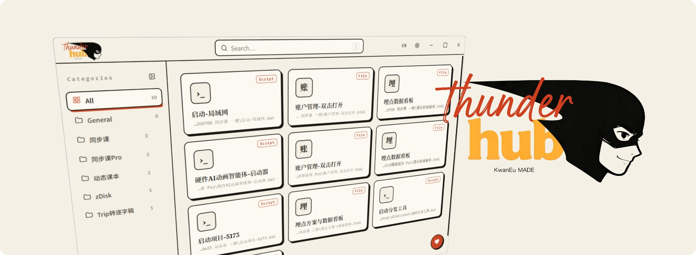
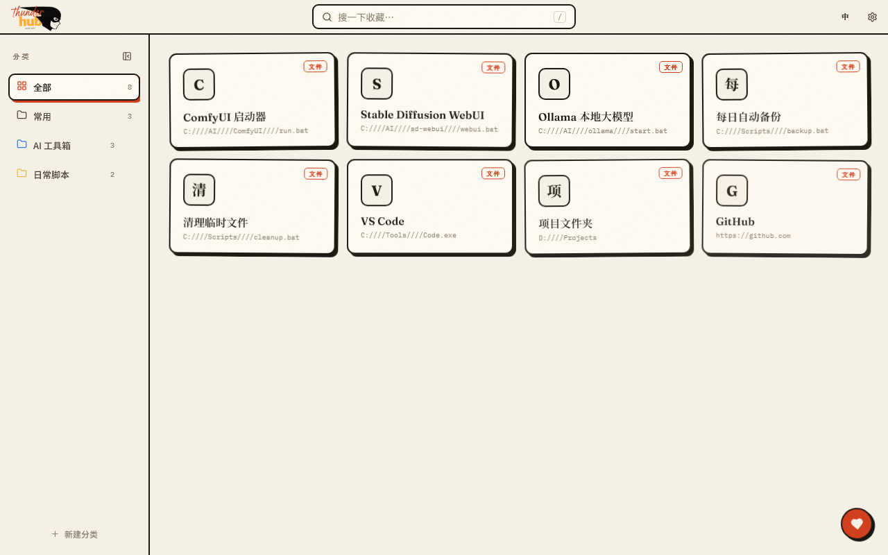
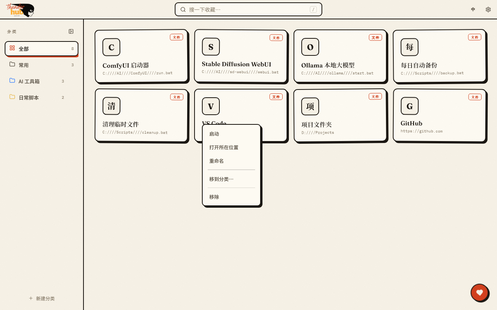
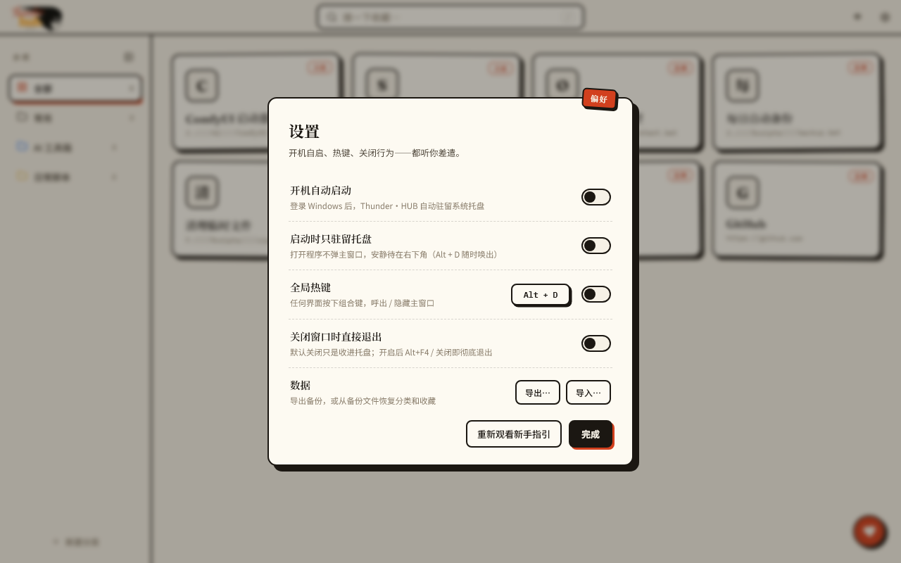
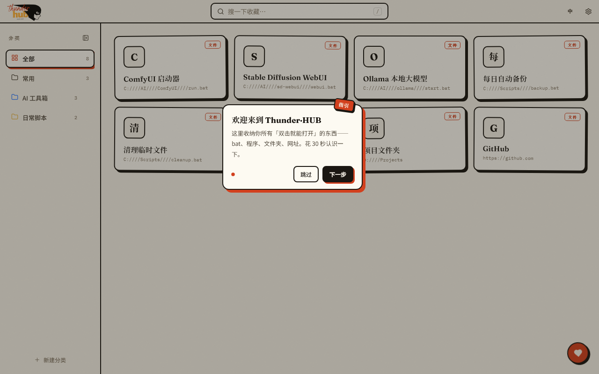

# Thunder·HUB

[中文](README.md) | **English**



> In the age of AI, everyone's desktop is littered with .bat files — Thunder·HUB collects them, sorts them, and launches them with one click.

## Why this exists

AI keeps getting stronger, and more and more people are vibe-coding little tools and agents — most of which start by double-clicking a `.bat` file.

Make enough of them, and a problem appears: your desktop and folders fill up with identical-looking bat icons, and every time you want to launch one, you have to hunt by filename.

Thunder·HUB is built for exactly that: **collect your bats (plus apps, shortcuts, folders and URLs), sort them into categories, then summon the launcher with a global hotkey — find it, click it, open it.** Always within reach.

A lightweight local launcher for Windows: double-click one `.bat` and a frameless app window opens; when you're done it retreats to the system tray. The UI is a cream-paper, black-ink, red-stamp sticker style.

## Screenshots

| Main window | Card context menu |
| --- | --- |
|  |  |

| Settings | Onboarding tour |
| --- | --- |
|  |  |

---

## Features

- **Effortless collecting**: click to add / system file picker / **just drag files, shortcuts and folders into the window** (they land in the selected category)
- **Real icons**: automatically extracts icons from exe files and shortcuts
- **Category sidebar**: create / rename / delete / drag to reorder / right-click to recolor, drag cards onto a category to file them, collapsible to an icon rail
- **Card management**: click to launch, double-click a name to rename inline, right-click menu (open location / move to category / remove), drag to reorder
- **System tray**: closing the window only hides it to the tray; right-click the tray icon to reopen or quit for real
- **Global hotkey**: `Alt+D` by default to show/hide, **any custom combo supported** (press-to-record)
- **Data backup**: one-click JSON export / import — move to a new PC or share your setup
- **Launch on startup**: one toggle in settings (writes to the Windows startup folder)
- **Thoughtful details**: search filter, window size/position memory, delete confirmation, respects the system "reduce motion" preference
- **Bilingual**: 中文 / English toggle in the title bar, preference remembered
- **Onboarding tour**: a four-step guided tour on first launch (replayable in settings)

## Quick start

### Requirements

- Windows 10 / 11 (the Edge WebView2 runtime is built into almost every system)
- Python 3.10+ ([download](https://www.python.org/downloads/) — check **Add to PATH** during install)

### Run

```
Double-click Thunder Hub.bat
```

On first run it auto-installs dependencies (`pywebview` / `pystray` / `pillow`); after that it's double-click and go, with no console window.

## Cheat sheet

| Action | How |
| --- | --- |
| Add an item | Press `A`, or drag files into the window (lands in the selected category) |
| Launch | Click a card / `Enter` launches the first search result |
| Search | Press `/` to focus the search box |
| New category | `Alt + N` |
| Rename | Double-click a card name / a category name |
| More actions | Right-click a card (open location, move to category, remove) |
| Reorder cards | Drag cards |
| Reorder categories | Drag categories in the sidebar |
| File a card | Drag it onto a sidebar category |
| Show / hide | `Alt + D` (customizable in settings) |
| Collapse sidebar | Button at the sidebar's top right |

## Settings

Open the settings panel via the gear in the title bar:

- **Launch on startup**: stays in the tray after you sign in to Windows
- **Start hidden in tray**: no window on launch — `Alt+D` whenever you need it
- **Global hotkey**: toggle + custom combo (applies after restart)
- **Quit on close**: by default closing only hides the window to the tray
- **Data**: export a backup, or restore categories and items from one

## Project structure

```
Thunder Hub.bat        Entry point (bootstrap: finds Python, installs deps, silent start)
server.py              Local server + window/tray/hotkey/icon extraction (stdlib + 3 deps)
icons.ps1              exe / lnk icon extraction (PowerShell)
app/
  index.html           UI structure
  style.css            Paper-sticker styling
  app.js               All frontend interactions
requirements.txt       Dependency list
```

The data file `launcher-data.json` (items, categories, settings) lives in the app directory as plain JSON — trivially backable-uppable.

## FAQ

**Q: Double-clicking the bat says Python is not found?**
Install Python 3.10+ with **Add to PATH** checked, or reopen the terminal after installing.

**Q: The window won't open / WebView2 errors?**
A few stripped-down systems lack the WebView2 runtime — grab it from [Microsoft](https://developer.microsoft.com/microsoft-edge/webview2/). If anything goes wrong, the app automatically falls back to a plain browser window.

**Q: The hotkey doesn't respond?**
If another program owns the combo it silently fails — pick a different one in settings. Hotkey changes apply after a restart.

## License

[MIT](LICENSE)
